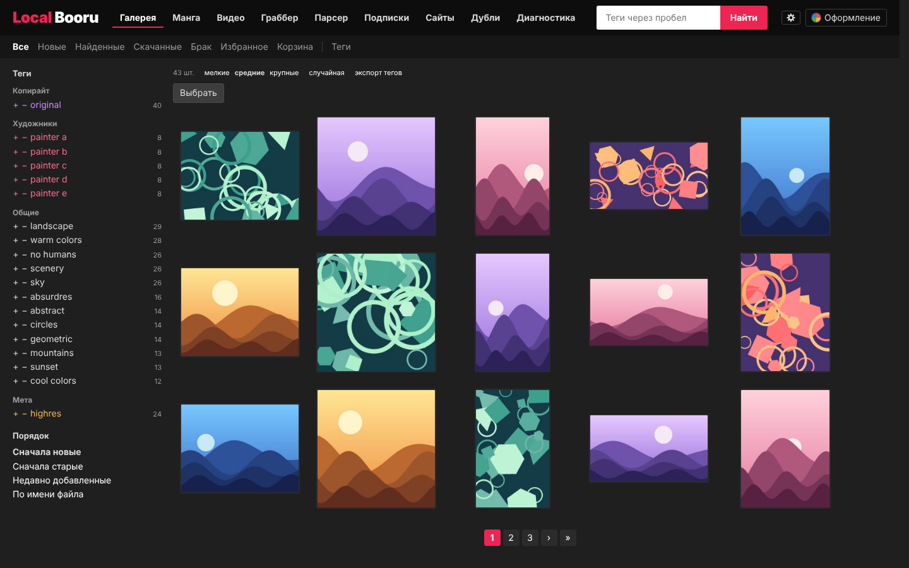
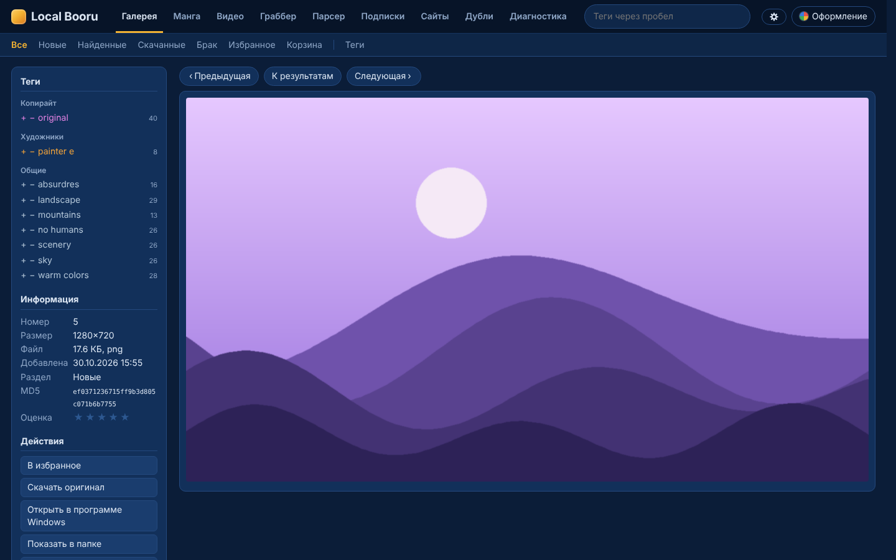
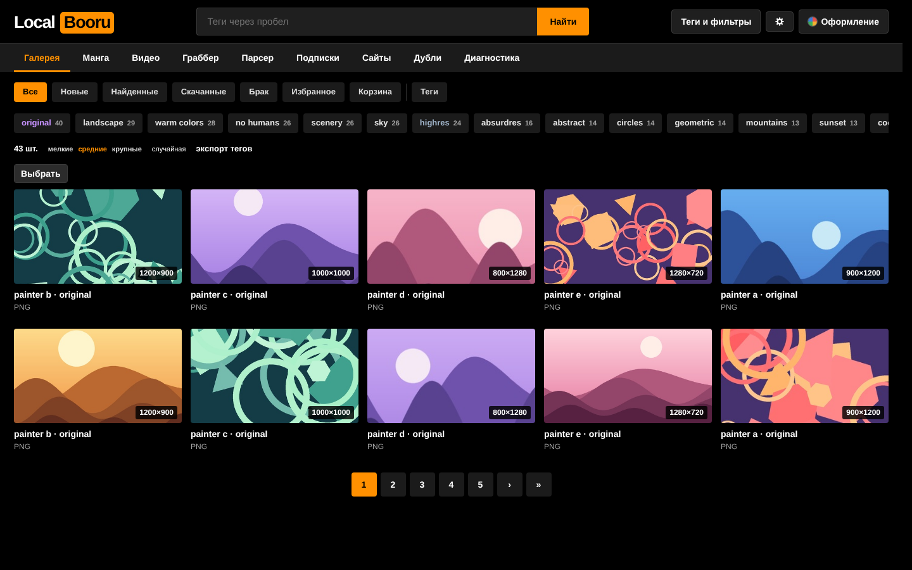
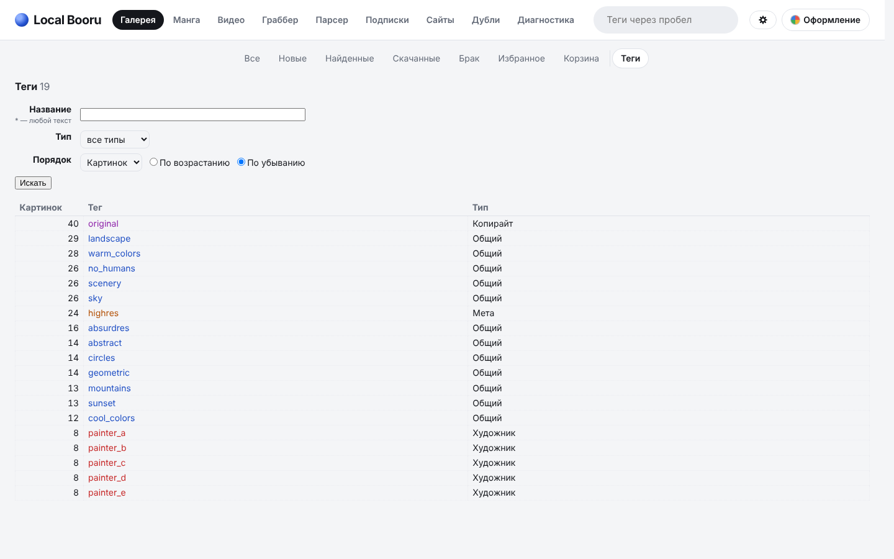
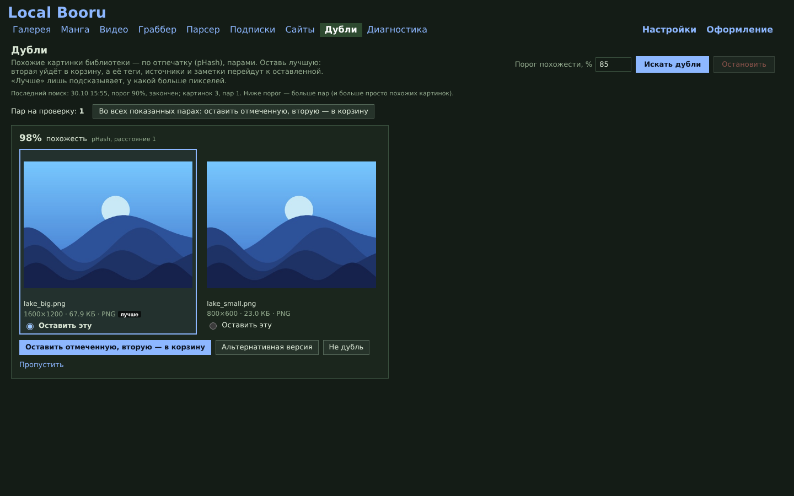

# Local Booru

**English** · [Русский](README_RU.md)

Local Booru is a booru-style gallery for your own archive of pictures, videos, manga and manhwa. It is a Windows
program that finds tags for your files by itself, keeps a gallery you search by tags, reads and downloads manga and
manhwa from their sites, shows your library on your phone, and helps keep a large archive in order. Everything stays
on your computer.

**[Download the latest version](https://github.com/Ucellar/Local_Booru/releases/latest)**



## What it does

- **Tags for your own files.** Each file is looked up on booru sites by an exact match of the file, by the same
  pixels in a file of another format, and through reverse image search services. The tags, sources and post links
  it finds are saved. What is not found goes to «Брак» (no match), to be checked again when you add sites.
- **Gallery.** Tag search: a space means all tags, `-tag` excludes one, `a/b` means either. Sections for new, found,
  downloaded, favorite and deleted pictures. Every picture has its own page with each site's tags, and the gallery
  has a tag list. Series and the pages of one work are shown as a single tile. The pictures you select, or everything
  a search found, go to the trash in one go.
- **Manga and manhwa.** Two tabs and one reader — for what you downloaded and for chapters from the sites: page by
  page or by scrolling, whichever suits the title. The program remembers where you stopped, what you read and which
  chapters are new; the parts of one title are stacked as one.
- **Titles from manga sites.** Find a title by its name or paste a link: read it right in the program without
  downloading anything, or download every chapter or only the ones you tick, with a queue and a pause. Paid chapters
  are never bought or bypassed: a chapter another site has for free is taken from there, otherwise it waits. The
  program checks the titles you downloaded for new chapters once a day. A title has one page: what is already in the
  folder, what you read, «Продолжить» (continue); you can pick its cover from every site's covers or use your own.
- **The feed.** The sites' catalogs as one list with filters: genres, tags, type, status, chapter count, rating, year.
  Every title has its own page: description, chapters, «Read» and «Download».
- **Manga in your folders.** The program recognizes the titles in your archive folders by itself — by their files,
  names and pictures — and adds the description, the cover and the missing chapters. Manga in the parser's folder goes
  to «Манга» only when a manga site confirms it (the pages matched); everything else is parsed as usual and becomes
  one set in the gallery. The program never changes the files of the source folder.
- **Videos.** Series from your folders and from the sites — on one page and in one player, resume where you stopped,
  «Skip opening / ending» buttons (found by the program itself), audio and subtitle tracks, ratings. «Download from a
  site» takes the files and open streams a page gives.
- **One download field.** Paste a link or type a name: the program tells by itself whether it is a post for the
  gallery, manga, manhwa or a video. All downloads are on the «Загрузки» page: one queue you can reorder, pause,
  carry on after a restart, a week of finished downloads and a retry of what failed.
- **Phone.** The gallery, manga, manhwa, videos and downloads on your phone work as on the computer, at home or
  anywhere — through Tailscale or your own server, with pages made for touch.
- **What to show.** A «SFW / All / NSFW» switch at the top of every page.
- **«Галерея (booru)» and subscriptions.** Search several sites by tags at once, with previews. Subscriptions to
  tags and artists check themselves and download only what is new: originals, nothing you already have.
- **Duplicates.** Similar pictures are shown in pairs: the better one stays, the other goes to the trash, and its
  tags move to the one you keep.
- **Diagnostics.** Library and database checks; one check and one repair of the files — the repair shows its plan
  first. Cleanup and reset first show what they will remove, and only then remove it.
- **A window with tabs.** The middle mouse button opens a page in a second window with tabs, so several titles load
  at once.
- **Browser extension** (Chrome, Edge, Firefox). Cards on the sites show what your library already has. A post goes
  to the program in one click, you can subscribe to a search right from the site, and posts with tags from your
  blocklist are blurred.
- **14 looks**, each with a light and a dark side, and every page can have its own.

 
 

*The screenshots show a test library of painted pictures.*

The interface is in Russian.

## Install

1. Download `Local_Booru_…_Windows_x64.zip` from the
   [releases page](https://github.com/Ucellar/Local_Booru/releases/latest) and unpack it into any folder.
2. Run `Local Booru.exe`.

Windows 10 or 11, 64-bit. The program keeps its database, settings and cache in `Documents\Local_Booru` by default.
In «Настройки → Папки» (Settings → Folders) you can gather them and the library's files into one archive folder
(`Local_Booru_Archive`), connect an archive you already have, or move the whole archive to another drive.

If the program window stays blank on your computer, the program draws its pages without the graphics card the next
time, and if that does not help either, opens them in your usual browser (Settings → Program window).

### Browser extension

1. Download `Local_Booru_Companion_…_Chrome.zip` or `…_Firefox.zip` from the same release and unpack it.
2. **Chrome / Edge:** open `chrome://extensions`, turn on Developer mode, click «Load unpacked» and choose the
   extension folder.
   **Firefox:** open `about:debugging` → This Firefox → Load Temporary Add-on, and choose `manifest.json`.
3. In the program: «Настройки» → «Браузер и расширение» → «Код для подключения расширения». Enter the code in the
   extension's window.

The extension talks only to the program on this computer (127.0.0.1), and only after it is paired with that code.

## Run from source

Python 3.11 is required.

```powershell
python -m venv .venv
.venv\Scripts\python -m pip install -r requirements.lock.txt
run.bat
```

To build the exe yourself, run `build_exe.bat`. The program appears in `dist\Local Booru`.

## Your data and keys

Pictures, the database and settings stay with you. Site keys and logins, if you enter any, are kept only in your
archive's settings and never written to the logs or the program's pages.

## License

[MIT](LICENSE)
