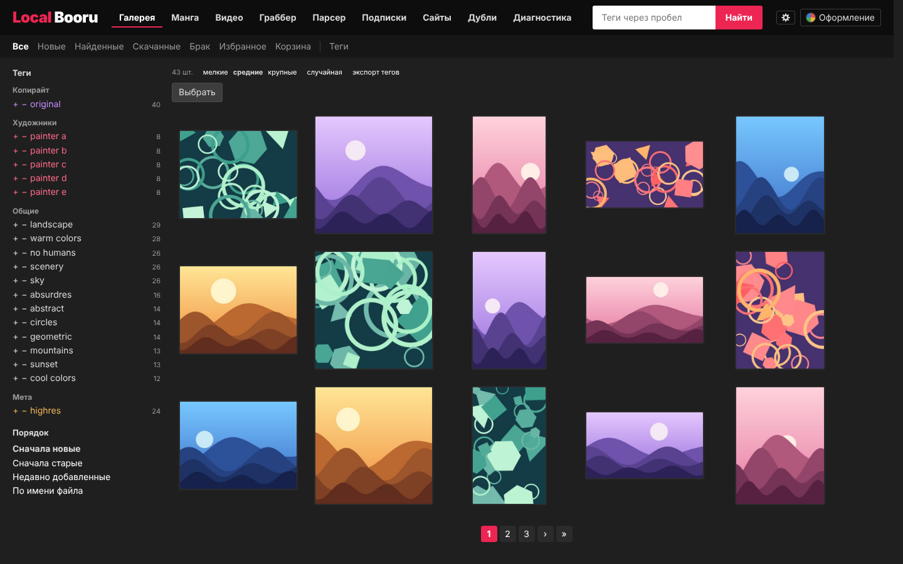
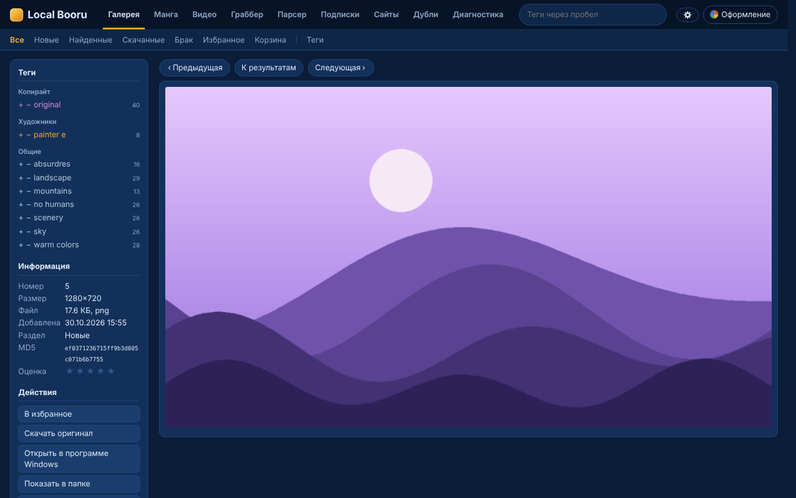
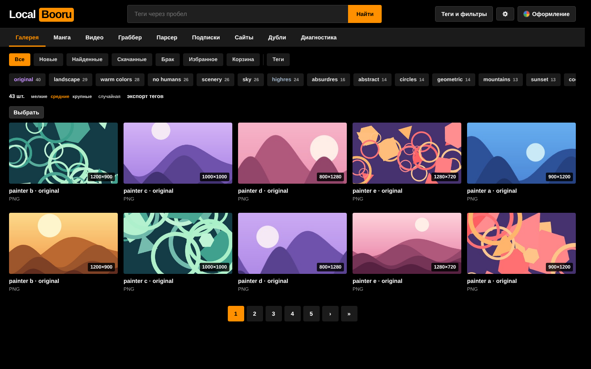
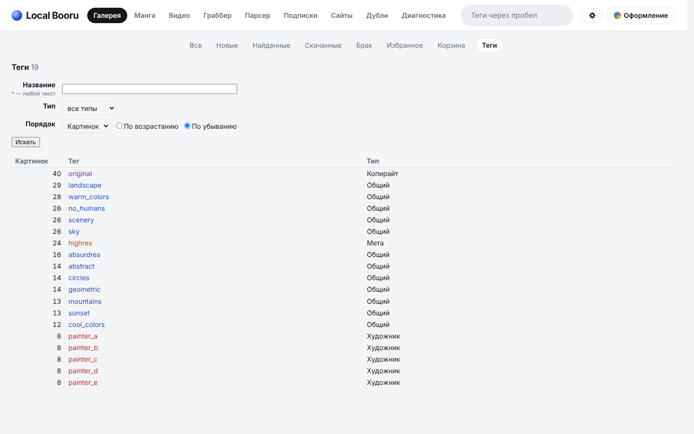
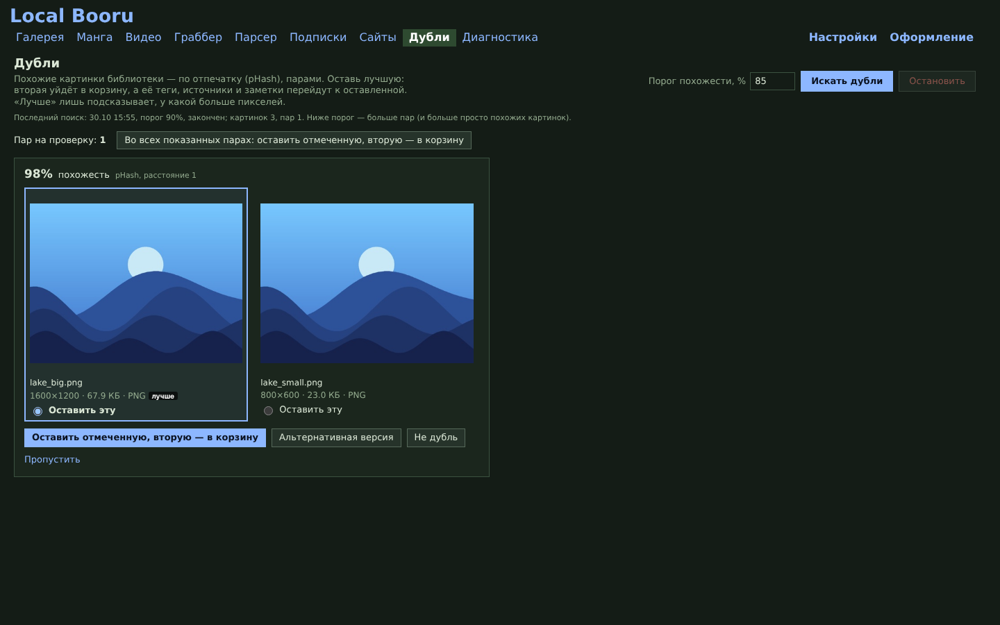

# Local Booru

[English](README.md) · **Русский**

Local Booru — галерея в духе booru для вашего собственного архива картинок, видео и манги. Программа для
Windows: сама находит теги к файлам, ведёт галерею с поиском по тегам и помогает держать большой архив в порядке.
Всё хранится у вас на компьютере.

**[Скачать последнюю версию](https://github.com/Ucellar/Local_Booru/releases/latest)**



## Что умеет

- **Теги к своим файлам.** Программа ищет каждый файл на booru-сайтах по точному совпадению файла, по тем же
  пикселям в файле другого формата и через сервисы поиска по картинке. Найденные теги, источники и ссылки на посты
  сохраняются. Что не нашлось, попадает в «Брак»: его можно проверить снова, когда добавятся новые сайты.
- **Галерея.** Поиск по тегам: «пробел» — все теги, `-тег` — без него, `a/b` — любой из двух. Разделы: новые,
  найденные, скачанные, избранное, корзина. У картинки своя страница с тегами каждого сайта, у галереи — список
  тегов. Серии и страницы одной работы собираются в одну плитку.
- **Манга и видео.** Читалка манги; части одного тайтла лежат одной стопкой. Вкладка видео: сериалы по папкам,
  просмотр с того же места, кнопки «Пропустить опенинг / эндинг» (программа находит их сама), озвучки и субтитры,
  оценки.
- **Граббер и подписки.** Поиск по тегам сразу на нескольких сайтах с превью. Подписки на теги и авторов
  проверяются сами и скачивают только новое: оригиналы, без повторов того, что уже есть.
- **Дубли.** Похожие картинки показываются парами: лучшая остаётся, вторая уходит в корзину, её теги переходят
  к оставленной.
- **Диагностика.** Проверка библиотеки и базы, обслуживание базы и файлов. Удаление и сброс сначала показывают,
  что будет удалено, и только потом удаляют.
- **Расширение для браузера** (Chrome, Edge, Firefox). На карточках сайтов видно, что уже есть в библиотеке.
  Пост скачивается в программу одним щелчком, на поиск можно подписаться прямо со страницы сайта, а посты с тегами
  из вашего блоклиста размываются.
- **11 оформлений.** У каждой страницы может быть своё.

 
 

*Скриншоты сделаны на тестовой библиотеке из нарисованных картинок.*

## Установка

1. Скачайте `Local_Booru_…_Windows_x64.zip` со страницы
   [релизов](https://github.com/Ucellar/Local_Booru/releases/latest) и распакуйте в любую папку.
2. Запустите `Local Booru.exe`.

Нужен Windows 10 или 11, 64-бит. База, настройки и кэш программы по умолчанию лежат в папке
«Документы\Local_Booru». В «Настройках → Папки» их можно собрать вместе с файлами библиотеки в одну папку архива
(`Local_Booru_Archive`), подключить архив, который уже есть, или перенести весь архив на другой диск.

Если окно программы на вашем компьютере остаётся пустым, при следующем запуске программа нарисует страницы без
видеокарты, а если не поможет и это — откроет их в обычном браузере («Настройки» → «Окно программы»).

### Расширение для браузера

1. Скачайте из того же релиза `Local_Booru_Companion_…_Chrome.zip` или `…_Firefox.zip` и распакуйте.
2. **Chrome / Edge:** откройте `chrome://extensions`, включите «Режим разработчика», нажмите «Загрузить
   распакованное» и выберите папку расширения.
   **Firefox:** откройте `about:debugging` → «Этот Firefox» → «Загрузить временное дополнение» и выберите
   `manifest.json`.
3. В программе: «Настройки» → «Браузер и расширение» → «Код для подключения расширения». Введите код в окне
   расширения.

Расширение разговаривает только с программой на этом компьютере (127.0.0.1) и только после подключения кодом.

## Запуск из исходников

Нужен Python 3.11.

```powershell
python -m venv .venv
.venv\Scripts\python -m pip install -r requirements.lock.txt
run.bat
```

Собрать exe самому: `build_exe.bat`. Готовая программа появится в `dist\Local Booru`.

## Данные и ключи

Картинки, база и настройки остаются у вас. Ключи и логины сайтов, если вы их вводите, хранятся только
в настройках вашего архива. В журналы и на страницы программы они не попадают.

## Лицензия

[MIT](LICENSE)
